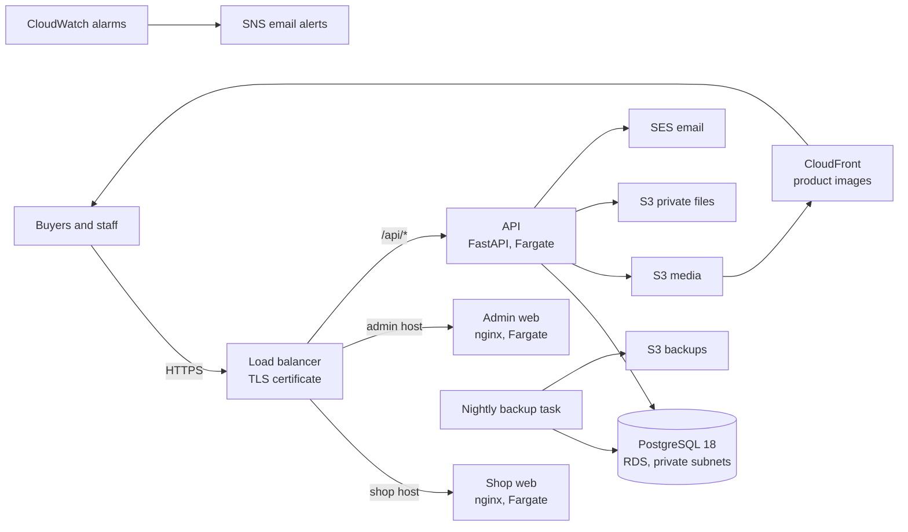

# Infrastructure (AWS)

Terraform code for running the shop on AWS. Staging is defined now. Production will reuse the same
module with larger settings once staging is signed off, and nothing goes to production without the
owner's go-ahead.

```
infra/terraform/
  bootstrap/       one-time per AWS account: Terraform state bucket + GitHub deploy role
  modules/shop/    everything one environment needs
  envs/staging/    staging settings; applied by .github/workflows/deploy-staging.yml
```

## What one environment contains



- **Network:** one VPC across two availability zones.
  - The database sits in private subnets with no internet route.
  - The app containers run in public subnets but accept traffic only from the load balancer.
- **Load balancer:** one HTTPS load balancer serves both host names. `/api/*` goes straight to the
  API; other paths go to the shop or admin container by host name. HTTP redirects to HTTPS.
- **API tasks** run `alembic upgrade head` in a short-lived container before the API starts (the
  tasks take turns on a lock). A deploy therefore migrates first, and a failed migration rolls the
  deploy back on its own. The load balancer only sends traffic to tasks whose `/health/ready` passes.
- **Secrets:**
  - The database password is managed by RDS in Secrets Manager.
  - `JWT_SECRET` and `MFA_ENCRYPTION_KEY` are generated by Terraform and kept in Secrets Manager.
  - ECS injects all of them at start-up. No AWS access keys exist; the API uses its task role.
- **Backups:** RDS automatic backups with 14 days of point-in-time recovery, plus the nightly
  `ops/db-backup.sh` dump to a versioned, encrypted bucket (kept 90 days). See
  [docs/operations.md](../docs/operations.md).
- **Alarms:** the list in docs/operations.md, emailed through SNS.

## First-time setup (once per AWS account)

You need: an AWS account used only for the shop, the AWS CLI and Terraform 1.13 on your computer,
and admin sign-in to the account (`aws sso login` or `aws configure`).

1. **DNS (recommended: Route 53).** Create a public hosted zone in Route 53 for your domain, or for a
   subdomain such as `shop.example.in`. Point the domain's name servers at it at your registrar.
   With the zone in Route 53, certificates, site addresses and email signing records are all
   created automatically. (DNS elsewhere also works: Terraform then lists the records to add, and
   the first deploy waits until the certificate validates.)
2. **Bootstrap:**
   ```bash
   cd infra/terraform/bootstrap
   terraform init
   terraform apply -var github_repository=santhoshsanjai/e-commerce
   ```
   Note the two outputs: `state_bucket` and `deploy_role_arn`.
3. **GitHub environment.** In the repository's Settings → Environments, create `staging` and add
   these variables (they are not secrets):

   | Variable | Example |
   | --- | --- |
   | `AWS_DEPLOY_ROLE_ARN` | output of step 2 |
   | `TF_STATE_BUCKET` | output of step 2 |
   | `AWS_REGION` | `ap-south-1` |
   | `BUYER_DOMAIN` | `staging.shop.example.in` |
   | `ADMIN_DOMAIN` | `admin.staging.shop.example.in` |
   | `EMAIL_DOMAIN` | `shop.example.in` |
   | `EMAIL_FROM` | `Shop <no-reply@shop.example.in>` |
   | `ALERT_EMAILS` | `["ops@example.in"]` |
   | `ROUTE53_ZONE_ID` | the hosted zone id from step 1 (leave empty if DNS is elsewhere) |

4. **Deploy.** Run the "Deploy to staging" workflow (Actions tab), or merge to `main`. The first run
   takes about 20 minutes, most of it creating the database.
5. **Confirm alert emails.** Each address in `ALERT_EMAILS` gets an email from AWS; click the link.
6. **Email sending.** New AWS accounts start in the SES sandbox, where emails only reach verified
   addresses. For staging, verify the addresses you'll test with (SES console → Identities). Before
   go-live, request production access in the SES console.
7. **First Super Admin.** No password goes through the terminal or AWS:
   ```bash
   terraform -chdir=infra/terraform/envs/staging init -backend-config="bucket=<state bucket>"
   ops/ecs-run.sh staging python -m app.cli create-superadmin \
     --email you@example.in --name "Your Name" --random-password
   ```
   Then open the admin site, choose "Forgot your password?", set a password from the email, and set
   up the authenticator app at your first sign-in.

## Everyday use

- **Deploys:** every merge to `main` deploys that commit to staging. The workflow builds the images
  (tagged with the commit), applies Terraform, waits for ECS to finish rolling out, and smoke-tests
  both sites.
- **Roll back:** re-run "Deploy to staging" from the previous commit (Actions → the earlier run →
  Re-run), or revert the commit on `main`.
- **One-off commands** (create an account, reset someone's two-step sign-in, rotate the MFA key):
  `ops/ecs-run.sh staging python -m app.cli <command>`.
- **Logs:** CloudWatch → Log groups → `/shop-staging/api` (and `buyer`, `admin`, `backup`). Queries
  are in docs/operations.md.

## Rough monthly cost of staging (ap-south-1)

An estimate. Check the AWS pricing calculator for current prices.

| Item | About |
| --- | --- |
| Load balancer | $20 |
| Database (db.t4g.micro, 20 GB, single zone) | $17 |
| Containers (API 0.5 vCPU / 1 GB, two web 0.25 vCPU / 0.5 GB, running all month) | $30 |
| Public IPv4 addresses (load balancer and tasks) | $18 |
| CloudWatch (logs, Container Insights, alarms), Secrets Manager, S3, CloudFront, SES | $10 to $20 |
| **Total** | **about $95 to $105 a month** |

Production adds a second database zone (Multi-AZ), two API tasks and more storage, so expect
roughly double.
